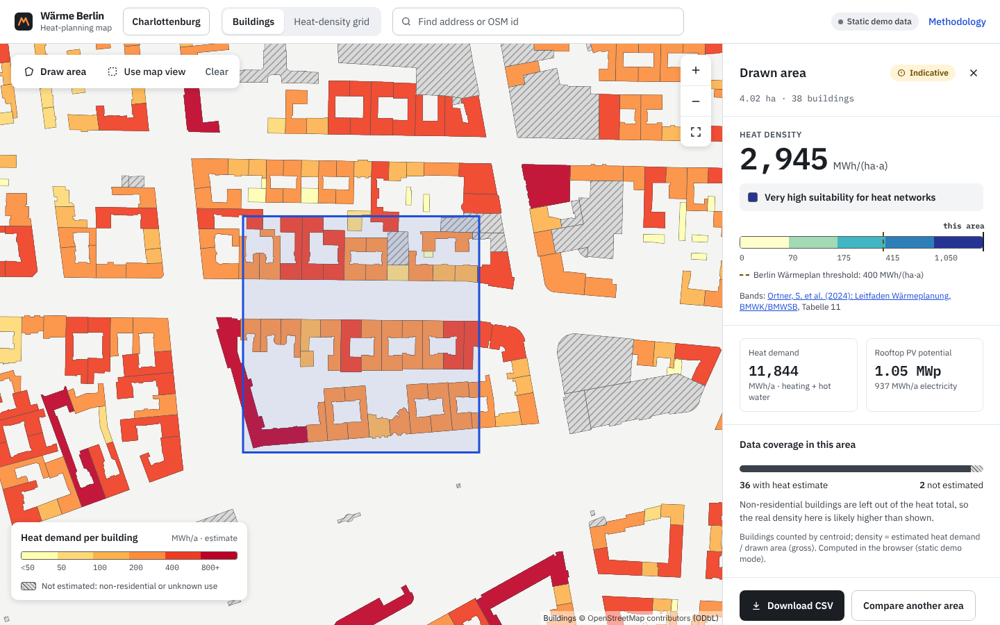
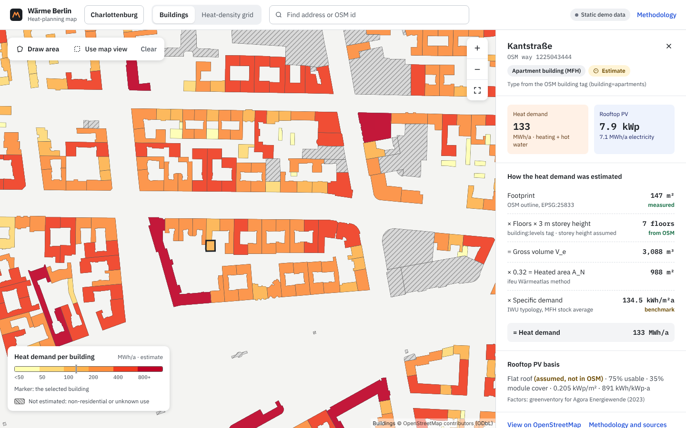
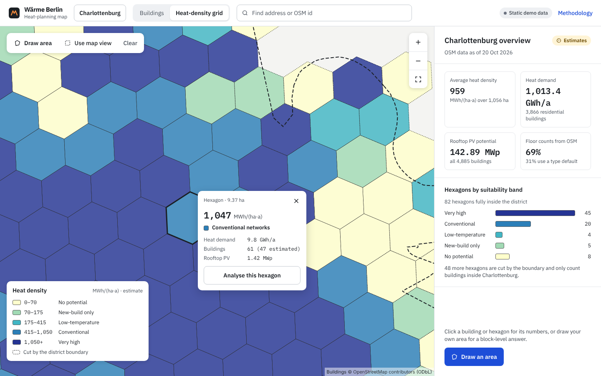
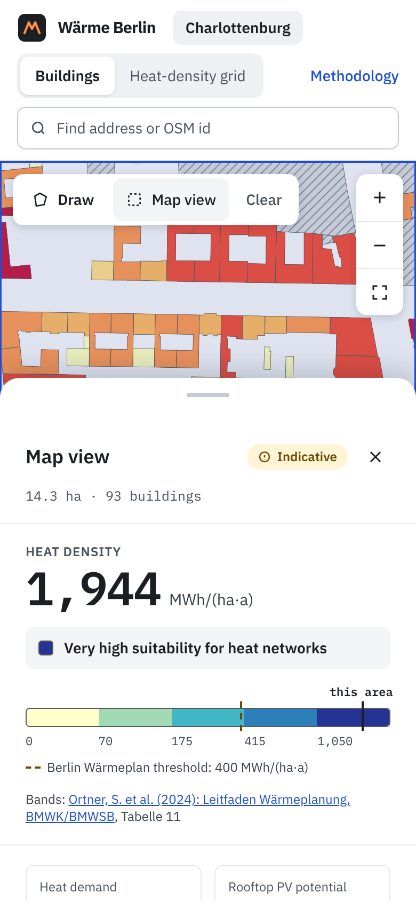

# Heat in Berlin: heat-planning map for Charlottenburg

A web map for one Berlin Ortsteil (Charlottenburg) that answers a heat planner's question:
**which blocks are dense enough in heat demand to justify a heat network, and how much rooftop PV could
they add?** It estimates annual heat demand and rooftop PV potential for each OpenStreetMap building, lets
you draw an area to get its **heat density in MWh/(ha·a)** with an indicative suitability band from the
federal *Leitfaden Wärmeplanung*, and shows a precomputed hexagon heat-density layer.

> **All numbers are estimates** from building geometry and published benchmarks. No metered consumption
> data is used. Method, sources and limitations: [docs/methodology.md](docs/methodology.md) and the
> `/methodology` page in the app.



| Building detail | Heat-density grid | Phone |
|---|---|---|
|  |  |  |

_Screenshots taken with the offline blank basemap used in tests; the deployed app uses an OpenFreeMap basemap._

**Live demo:** https://heat-in-berlin.vercel.app/ (static demo mode: precomputed data, area analysis runs in the browser)

## Features

- Map-first workspace: 4,885 OSM buildings coloured by estimated heat demand (colour-blind-safe YlOrRd ramp
  with tick labels, hatch for "not estimated"), or an H3 hexagon heat-density layer (~10.5 ha cells).
- District overview (default panel): average density, totals, share of OSM floor counts, hexagons per band.
- Building detail as a calculation chain (footprint → floors → volume → A_N → demand), each step tagged
  measured / from OSM / assumed / benchmark; PV basis; the building's class is marked on the legend.
- Area analysis from a drawn polygon, the current map view, or a clicked hexagon: density, verdict and a
  band scale with Berlin's 400 MWh/(ha·a) threshold, totals, data coverage, a warning when the area extends
  outside the district, CSV export of the counted buildings, and comparison with the previous area.
- Keyboard: address/OSM-id combobox; focus the map and press Enter for the building under the crosshair;
  "Use map view" as a non-pointer alternative to drawing.
- Phones: compact top bar and a collapsible bottom sheet.
- Static demo mode: without an API, the app reads the precomputed GeoJSON and runs the area analysis in the
  browser (tested for parity with the Python implementation).

## Stack

- **Frontend:** Next.js 16 (App Router), React 19, TypeScript, MapLibre GL JS 6, Terra Draw, TanStack Query 5,
  Tailwind CSS 4, IBM Plex (self-hosted via Fontsource), Turf. Tests: Vitest + Testing Library, Playwright.
- **Backend:** Django 5.2 + Django REST Framework, shapely, pyproj, h3. Tests: pytest.
- **Data prep:** `backend/scripts/` (Overpass → estimates → GeoJSON).
- **Delivery:** Docker Compose, GitHub Actions.

## Run it

```bash
# Full stack with Docker
docker compose up --build        # web on http://localhost:3000, API on http://localhost:8000

# Or separately
python3 -m venv .venv && .venv/bin/pip install -r backend/requirements-dev.txt
cd backend && ../.venv/bin/gunicorn config.wsgi -b 127.0.0.1:8000     # API
cd web && npm ci && NEXT_PUBLIC_API_URL=http://localhost:8000 npm run dev  # frontend
cd web && npm ci && npm run dev                                          # static demo mode, no API
```

API: `GET /api/buildings?bbox=minLon,minLat,maxLon,maxLat`, `POST /api/analyse` (GeoJSON Polygon),
`GET /api/hexagons`, `GET /api/meta`, `GET /api/health`.

## Rebuild the data

```bash
python3 backend/scripts/fetch_osm.py               # Overpass → data/raw/charlottenburg.overpass.json
.venv/bin/python backend/scripts/coverage.py       # OSM tag coverage
.venv/bin/python backend/scripts/build_layers.py   # → data/derived/ and web/public/data/
.venv/bin/python backend/scripts/make_parity_fixture.py
```

## Tests

```bash
cd backend && ../.venv/bin/python -m pytest         # 67 tests
cd web && npm test                                  # 41 tests
cd web && npm run test:e2e                          # 4 Playwright tests
```

## Methodology in short

- **Heat (residential only):** A_N = 0.32 × footprint × floors × 3.0 m (ifeu Wärmeatlas method) ×
  specific demand from the IWU German residential typology (2015, Anhang C.3, existing state, calibrated to
  consumption): EFH 142.4, RH 118.2, MFH 134.5 kWh/(m² A_N·a), stock-weighted over age classes.
- **PV:** footprint → roof area → usable area → module area → kWp using the factors of greenventory's
  2023 rooftop-PV study for Agora Energiewende; 891 kWh/kWp·a derived from Berlin's Solaratlas totals.
- **Suitability:** heat density bands 0 / 70 / 175 / 415 / 1,050 MWh/(ha·a) from the Leitfaden Wärmeplanung
  (Tabelle 11, p. 54); Berlin's Wärmeplan threshold of 400 shown for comparison.

## Limitations

Building age unknown (German stock average used); non-residential heat not estimated; 31 % of floor counts are
type defaults; mixed-use treated as residential; PV ignores shading, orientation and structural suitability;
density bands refer to final energy while the tool uses heat generation. Full list on the methodology page.

## Measurements

See [docs/measurements.md](docs/measurements.md): measured API times, time to first map render, Lighthouse,
test counts, with the environment for each.

## Repository layout

```
backend/   Django API (config/, heat/), estimation library (waerme/), scripts/, tests/
data/      raw/ (OSM extract, committed), derived/ (generated layers)
docs/      methodology, data coverage, measurements, AI-assisted development log
web/       Next.js app (app/, components/, lib/, test/, e2e/)
```

## Licences

Code: MIT. Map data © OpenStreetMap contributors, available under the
[Open Database License](https://opendatacommons.org/licenses/odbl/); the derived layers in `data/derived`
and `web/public/data` are also ODbL.
